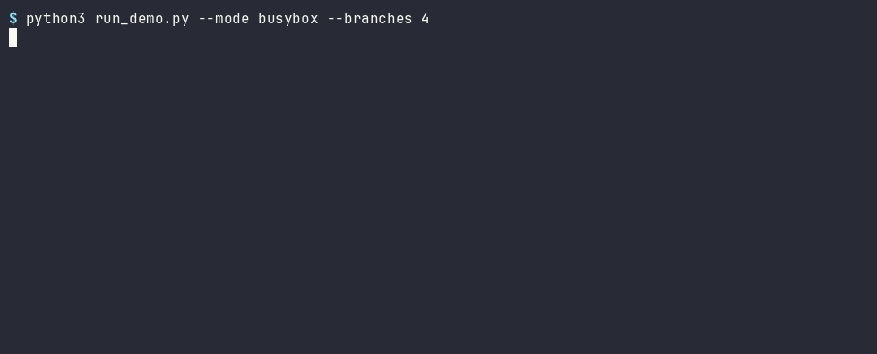

<h1 align="center">k7d</h1>

<p align="center">
  <b>Fork a running Kubernetes cluster in ~100&nbsp;ms.<br/>Run 50 copies on one 64&nbsp;GB box.</b>
</p>

<p align="center">
  <a href="https://github.com/Katakate/k7d/stargazers"></a>
  <a href="https://docs.katakate.org">
    
  </a>
  <a href="https://deepwiki.com/Katakate/k7d"></a>
  <a href="LICENSE"></a>
  
  <a href="#formal-verification"></a>
  <a href="https://beci.me/blog"></a>
</p>

<p align="center">
  
</p>

<p align="center">
  <a href="LATENCY_BUDGETS.md"></a>
  <a href="LATENCY_BUDGETS.md"></a>
</p>

<p align="center">
  
</p>

RL training and agent evals whose environments are **Kubernetes** —
clusters, charts, in-cluster workloads — need thousands of isolated,
resettable worlds. Not one sandbox, and not a cold `kind` cluster per
trial. Booting a fresh Kubernetes cluster takes ~30&nbsp;s and full RAM
per copy. k7d boots it **once**, then forks the live cluster in
~100&nbsp;ms; forks share memory until they diverge, so 50 copies cost
dirty pages, not 50&nbsp;× full guest RAM.

The same engine is also a great **fork-first VMM** when your unit is a
single VM sandbox (including docker-in-VM): blazing-fast warm forks with
faithful snapshotting of memory, disk, processes, and networking. For
running that at scale — Kubernetes orchestrating your sandboxes, plus a
CLI / API / Python SDK for agents — see the sibling project
**[Katakate k7](https://github.com/Katakate/k7)**.

> <b>100% open‑source</b> (Apache‑2.0). For technical support, write us at: hi@katakate.org

## Why k7d

- ⚡ **Fork a running Kubernetes cluster in ~100&nbsp;ms** — and pack
  **50 copies on one 64&nbsp;GB box**. Cold-booting a fresh cluster
  takes ~30&nbsp;s and a full RAM bill per copy; k7d boots once, then
  copies share memory until they diverge.
- 🔁 **The cluster keeps running after the fork** — no agent restarts,
  no broken TLS, no "please wait while Kubernetes comes back." Each
  copy looks identical to the original from the inside.
- 🌲 **Built for AI agents that explore many worlds** — fork a branch,
  try something, keep the winners, throw away the losers. The agent
  decides what to keep; k7d enforces RAM and disk budgets so the tree
  doesn't eat the machine.
- 🧊 **Also a blazing-fast VM-sandbox VMM** — warm-fork a single guest
  in ~5&nbsp;ms with faithful memory / disk / process / network state.
  Ideal for docker-in-VM and any workload that needs resettable
  isolated machines, not only whole k8s clusters. Pair with
  [Katakate/k7](https://github.com/Katakate/k7) when you want k8s
  orchestration + Python SDKs on top.
- 🔬 **We use formal methods where they pay off** — [Kani](https://model-checking.github.io/kani/)
  on selected `unsafe` / arithmetic paths, and
  [Aeneas](https://aeneasverif.github.io/)→Lean on the tree
  budget/eviction model. Not a claim that everything is proven —
  details [below](#formal-verification).
- 🪶 **≤25k lines of Rust for the VMM + shim** — small enough to read
  and audit. Deliberately not a kitchen-sink VMM.
- ✅ **Every number here is a CI assertion** — not a one-off benchmark
  paste. If a latency claim drifts, a test fails. Methodology:
  [the benchmark write-up](docs/blog/2026-08-07-k7d-cluster-fork-benchmark.md).

## Quickstart

You need a Linux **amd64 / x86_64** host with KVM (`/dev/kvm` present) —
same ISA (`amd64` is the Debian name; tarballs use `x86_64`). No arm64
build yet. Rust and Docker are required to build from source. Prebuilt
release tarballs are produced by `make release`
(`k7d-v*-x86_64-linux.tar.gz` + `install.sh`).

```bash
git clone https://github.com/Katakate/k7d && cd k7d
make release                          # daemon, shim, guest kernel, rootfs → dist/
sudo RUST_LOG=info ./dist/k7d &       # owns VMs + /run/k7d/k7d.sock

cd examples/cluster-tree-search
python3 run_demo.py --mode busybox --branches 4
# density claim:  python3 run_demo.py --mode busybox --branches 50
```

The demo forks a live 3-VM cluster, scores branches, keeps the winner,
prunes the losers, and prints the fork wall-clock. To put real
Kubernetes pods *inside* those VMs (`runtimeClassName: k7`), see
[`HACKING.md`](HACKING.md). Full docs (API reference, installers) will
ship separately — this README is the product pitch + getting started.

## Using k7d for GRPO / agent tree search

If you already have Kubernetes tasks or scenarios (a Helm chart, a
set of YAML manifests, an eval harness that talks to a kube-apiserver),
the shape is:

1. **Boot the scenario once** — bring up your cluster (or adopt a
   running one that k7d already hosts) and wait until it is in the
   state you want every rollout to start from.
2. **Root a tree at that checkpoint.**
3. **For each GRPO group (or tree-search step):**
   `fork_batch(N)` → run your N policies against the N copies → score
   → `protect` the winners, `prune` the losers → let the daemon
   `auto_evict` under your RAM/disk budget.
4. **Roll forward** from a protected winner when you want the next
   generation to start from a better state, or `rollback` to an
   earlier node when you don't.

### Why byte-identical starts matter for GRPO

GRPO (and most group-relative methods) compare rewards *within a
group*. If member A starts from a colder cache, a different etcd
revision, or a half-ready Deployment than member B, the reward gap is
noise, not signal. A k7d fork is a copy of the live machine — same
memory, same disk, same in-cluster TLS sessions, same kube-apiserver
state. Every member of the group begins from a **byte-identical**
world, then diverges only because of what your policy did.

That is the difference between "we reset the env" and "we cloned the
universe."

### How your agent talks to the tree

Your training loop owns rewards and policy. k7d owns environments and
budgets. The agent talks JSON-lines over a Unix socket
(`/run/k7d/k7d.sock`). The verbs you actually need:

| You want to… | Call |
|---|---|
| Start from a warm VM or live cluster | `tree_create` / `tree_create_cluster` / `tree_adopt_cluster` |
| Open N parallel rollouts from one checkpoint | `tree_fork_batch` |
| Try again from an earlier node without destroying it | `tree_rollback` |
| Pin a winner so budget pressure can't kill it | `tree_protect` |
| Drop a losing subtree | `tree_prune` |
| Enforce RAM/disk caps now | `tree_auto_evict` |

A thin Python client that covers exactly this loop lives in
[`examples/cluster-tree-search/`](examples/cluster-tree-search/). Treat
it as the template for wiring your GRPO trainer — not as a finished
SDK. The full API reference will live in the docs site.

## How it works (the non-obvious bits)

You do not need to be a VMM engineer to use k7d. You do need to know
*why* a 100&nbsp;ms cluster fork is even possible, because that is the
product.

**Memory is shared until someone writes.** Guest RAM lives in one file.
A fork pauses the source for a moment, notes which pages changed since
the last checkpoint, maps the child's memory as a copy-on-write view of
the parent's, and copies only those dirty pages. Everything else is
shared. That is why 50 forks of a cluster fit in 64&nbsp;GB: you pay for
divergence, not for the base.

**The cluster does not reboot because the network lies consistently.**
Each cluster lives on its own private Linux bridge. A fork gets a
*new* bridge with the *same* guest IPs and MAC addresses as the source.
From inside the guest, nothing moved — same addresses, same ARP cache,
same TLS certs, same established TCP — so kubelet, the CNI, and the
control plane keep running. Separate bridges mean forks cannot see each
other. Without this, every fork would force a kubelet restart and a
~1–2&nbsp;s agent restart per node, and the 100&nbsp;ms claim would be
impossible.

**Forks live in a tree the daemon manages under budget:**

```text
base cluster ──► fork A ──► fork A1   (protected: winner)
             ├─► fork B                (pruned: low reward)
             └─► fork C ──► rollback ─► fork C'
```

### Three tricks that had to be right

These are the kinds of bugs that silently break "byte-identical."
[`CHALLENGES.md`](CHALLENGES.md) has all 56; these three are the
headline ones:

1. **Device writes are invisible to the hypervisor's dirty log.**
   Block devices in k7d write guest memory from userspace. The
   hypervisor only sees CPU writes — so a fork taken after disk I/O
   would resurrect *pre-I/O* bytes on those pages (silent corruption).
   Fix: track device dirty pages ourselves and merge them into the
   fork bitmap, and drain in-flight I/O before the bitmap is read.
   ([CHALLENGES.md #43](CHALLENGES.md))
2. **A restored guest with a blank timer chip freezes time.** After
   fork, the interval timer was left unprogrammed — no timer
   interrupts, `CLOCK_REALTIME` stuck, and Kubernetes quietly parks.
   Fix: re-arm the timer (and reset the paravirtual clock) on every
   restore. ([CHALLENGES.md #40](CHALLENGES.md))
3. **Identical IPs only work if the L2 domains are separate.** Replay
   the source's addresses onto a fresh bridge per fork. Same view
   from inside; no conflicts across forks. That is the zero-restart
   trick above.

## Measured numbers

On one bare-metal box (~€40/month bare-metal: Ryzen 5 3600, 6 cores,
64&nbsp;GiB, NVMe):

| Scale check | Measured | Enforced budget |
|---|---|---|
| Warm single-VM fork (&lt;25% dirty) | ~5 ms | 50 ms |
| Warm-fork a live **3-node k3s cluster** (under API churn) | **~105 ms** | 1 s |
| **50 × 3-VM** cluster-tree forks (shared pause) | **~4.1 s** (~82 ms/cluster) | 20 s |
| VM boot → guest agent ready (cold) | ~163 ms | 250 ms |

Every row is an integration-test assertion
([`LATENCY_BUDGETS.md`](LATENCY_BUDGETS.md)). Full methodology:
[the benchmark write-up](docs/blog/2026-08-07-k7d-cluster-fork-benchmark.md).

## Kubernetes feature support

Two layers — most RL users only care about the first.

### Inside a forked cluster (your GRPO scenario)

This is the k3s that lives *inside* the VMs you fork. The fork engine
is **N-node** (`tree_create_cluster(vm_count)` / adopt any live set) —
there is no hard-coded 3. The CI fixture that proves the headline
numbers is a 3-node control plane with flannel + kube-proxy and a real
in-cluster Deployment; several stock k3s add-ons are still disabled
there to keep that path lean. Status below mixes “API can do it” with
“fixture exercises it.”

| Feature | Status | Notes |
|---|---|---|
| k3s control plane (server + agents) | ✅ Today | Fixture proves 3 Ready nodes; TLS / node IPs survive fork |
| **N-node clusters** (5, 20, …) | ✅ Today | Same fork path for any `vm_count`; limited by **host RAM**, not by the API. At ~3.2 GiB/node, a 20-node base alone is ~64 GiB — shrink guest memory (or use a bigger box) and it forks like the 3-node case |
| Flannel (`host-gw`) | ✅ Today | Shared L2 between member VMs |
| kube-proxy (ClusterIP by IP) | ✅ Today | |
| Deployments / ReplicaSets / Pods | ✅ Today | e.g. `inner-load` Ready on source *and* fork |
| ConfigMaps / Secrets (as in-cluster objects) | ✅ Today | Exercised under churn before fork |
| overlayfs snapshotter (guest containerd) | ✅ Today | |
| CoreDNS | 🔜 Soon | Disabled in the current fixture; re-enable is next |
| Traefik / Ingress | 🔜 Soon | Same — disabled today, queued with CoreDNS |
| ServiceLB / metrics-server | 🔜 Soon | Disabled in the fixture |
| `local-path` / in-cluster PVC provisioning | 🔜 Soon | Disabled (`local-storage` off) |
| NetworkPolicy | 🔜 Later | Disabled today (`--disable-network-policy`) |
| Cilium (eBPF CNI / policies) | 🔜 Later | Not validated inside the guest; outer host may run Cilium |
| Longhorn / CSI drivers (iSCSI, NFS, …) | 🔜 Later | Guest kernel is minimal; no CSI path yet |
| Nested `hostNetwork` pods | ❌ Not today | Known failure mode in the guest |

If your scenario needs CoreDNS + Ingress tomorrow, say so — re-enabling
the stock add-ons is the next fidelity bump, not a redesign. Same for
a larger CI fixture: wiring 20 nodes is configuration + RAM, not a new
fork feature.

### Host RuntimeClass (pods *as* k7d VMs)

This is the outer layer: kubectl on the host schedules pods into k7d
microVMs via `runtimeClassName: k7`. Relevant if you also want
single-VM sandboxes, not only whole-cluster forks.

| Feature | Status | Notes |
|---|---|---|
| `runtimeClassName: k7` (CRI / containerd shim) | ✅ Today | |
| `kubectl logs` / `exec` / `exec -it` (PTY) | ✅ Today | Incl. resize, Ctrl-C, detach |
| Pod IP, Services, DNS, egress | ✅ Today | Host CNI dataplane |
| ConfigMap / Secret / projected / downwardAPI / emptyDir | ✅ Today | |
| hostPath, local-path PVC, k7d RWO disk volumes | ✅ Today | |
| Memory / CPU limits; multi-container / sidecars | ✅ Today | |
| Warm VM + whole-cluster fork / snapshot tree | ✅ Today | The point of the project |
| Init containers; natural exit / `restartPolicy` | ✅ Today | Multi-container pods |
| Multi-vCPU guests (`cpu: "2"+`) | ✅ Today | From pod CPU limits; fork/snapshot parity |
| `hostNetwork`, NetworkPolicy, IPv6, arbitrary CSI / RWX | 🔜 Later | |
| Cross-node fork | 🔮 Later | Host-local trees today |

## Why not Firecracker / Kata / E2B-style sandboxes?

| | Firecracker | Kata | CubeSandbox / E2B-style | **k7d** |
|---|---|---|---|---|
| Warm fork of a **running** VM | snapshot → restore | no | snapshot + N restores (~220 ms) | live copy-on-write fork (**~5 ms**) |
| Snapshot tree (fork / rollback / protect / budget) | no | no | SDK around sandboxes | yes — daemon API |
| Forks a **whole k8s cluster** | no | no | no | **yes** (~105 ms) |
| Runs as a Kubernetes RuntimeClass | via FC-containerd | yes | no | yes (`runtimeClassName: k7`) |
| Formal methods | audit/fuzz culture | — | — | Kani + Aeneas on selected paths (memory math, tree budgets) |

They fork a sandbox. k7d forks a **VM or an entire cluster**.
Deliberately not E2B-API compatible — different job.

## Security model & limitations

- **One daemon, many VMs, one address space.** Live copy-on-write fork
  requires parent and child memory to be mappings in the same process.
  Guest→host isolation is still KVM; isolation *between sibling forks
  of the same tenant* is weaker than Firecracker's
  one-jailed-process-per-VM. k7d is built for fleets of *your own*
  environments, not hostile multi-tenant isolation between forks.
- **What survives a fork:** everything inside the forked set —
  in-cluster TLS, established TCP between member VMs, disk state.
  Guest clocks are reset so time does not jump backwards.
- **What doesn't:** TCP to the outside world (the far end never
  forked). Forks keep their in-cluster addresses; only the
  host-facing identity is new.
- **Single host, x86_64 Linux + KVM only.** Cross-node fork is on the
  roadmap. Does not build on macOS/Windows.
- **Young project.** ≤25k LOC for the VMM + shim, one primary test
  machine, no security audit yet. Small surface by design.

## Formal verification

Selected critical pieces are machine-checked — not the whole runtime:

| Tool | What it covers |
|---|---|
| [Kani](https://model-checking.github.io/kani/) | Bounded proofs over selected `unsafe` / address-arithmetic harnesses |
| [Aeneas](https://aeneasverif.github.io/) → Lean | Functional correctness of the snapshot-tree budget / LRU eviction model |

```bash
make kani                      # selected unsafe / arithmetic harnesses
make verif-gen verif-build     # regenerate Lean model + prove it
```

## Roadmap

- ✅ Warm single-VM fork, snapshot trees, budget eviction
- ✅ containerd shim + `runtimeClassName: k7`
- ✅ Live 3-node k3s cluster fork (~105 ms)
- ✅ Kani + Aeneas proofs on selected critical paths
- ✅ Prebuilt release tarball + `install.sh` (`make release`)
- 🔜 Config file (`/etc/k7d/config.toml`)
- 🔮 Cross-node fork

## Digging deeper

- [beci.me/blog](https://beci.me/blog) — a six-part write-up on how and why k7d was built, from the RL motivation to the formal verification
- [`docs/blog/2026-08-07-k7d-cluster-fork-benchmark.md`](docs/blog/2026-08-07-k7d-cluster-fork-benchmark.md) — hardware, exact commands, methodology
- [`CHALLENGES.md`](CHALLENGES.md) — 56 non-trivial bugs with root causes and time lost (the three above are the headline; start anywhere)
- [`docs/architecture.md`](docs/architecture.md) / [`docs/concepts.md`](docs/concepts.md) — design notes for systems readers
- [`HACKING.md`](HACKING.md) — build, test, and the RuntimeClass install steps
- [Katakate/k7](https://github.com/Katakate/k7) — sibling project: use k7d-class VM sandboxes at scale with Kubernetes orchestration, a CLI/API, and a Python SDK for your agents

## License

Apache-2.0 — see [`LICENSE`](LICENSE).
