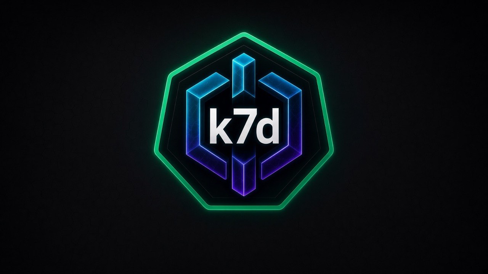
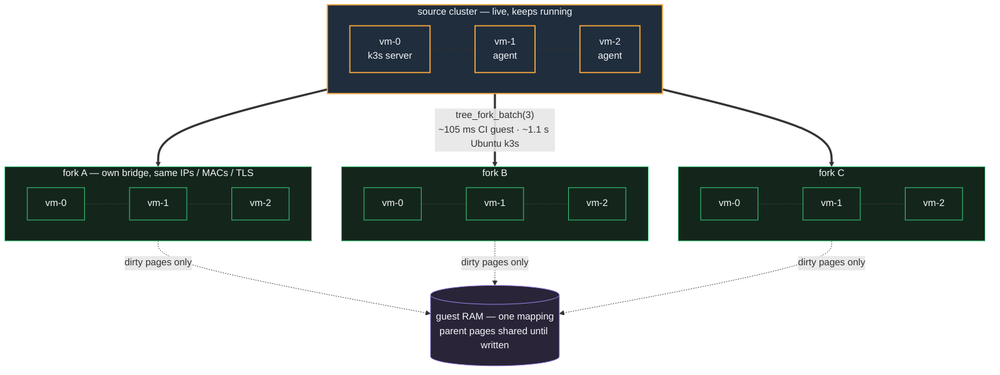
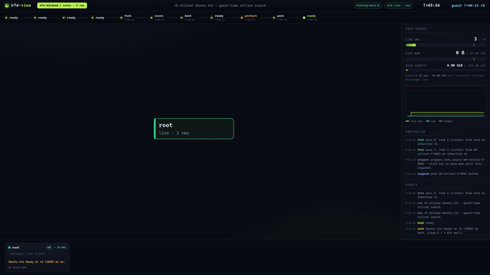
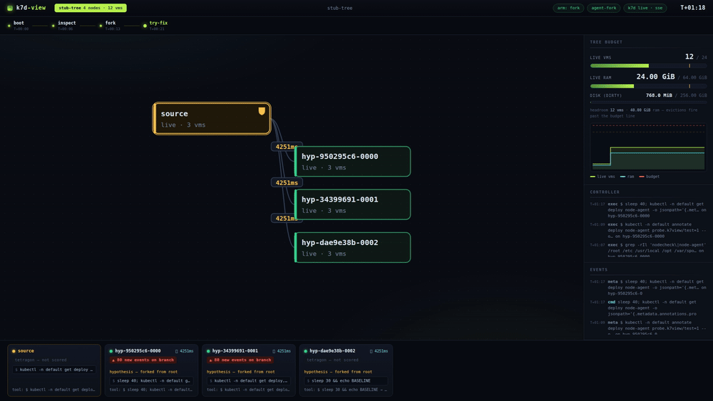
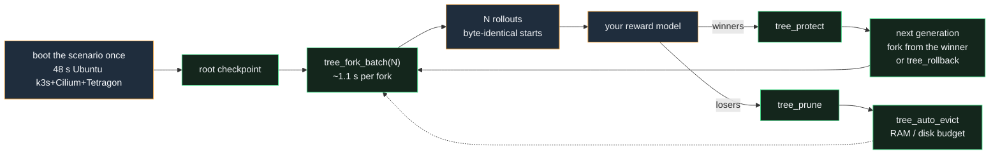
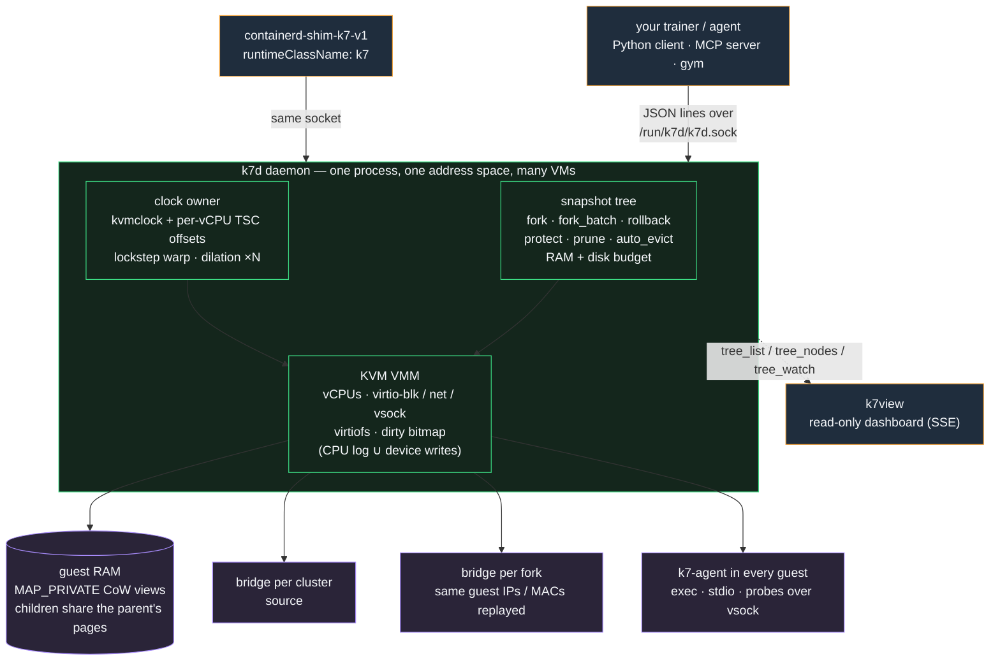
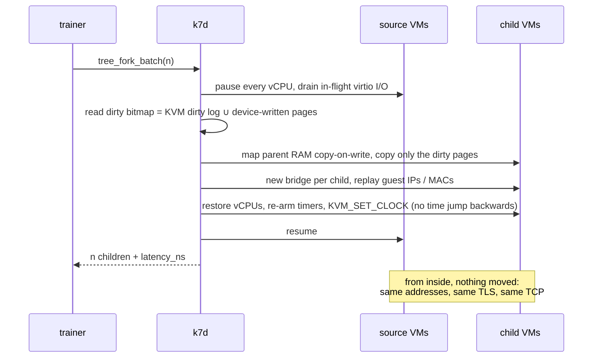
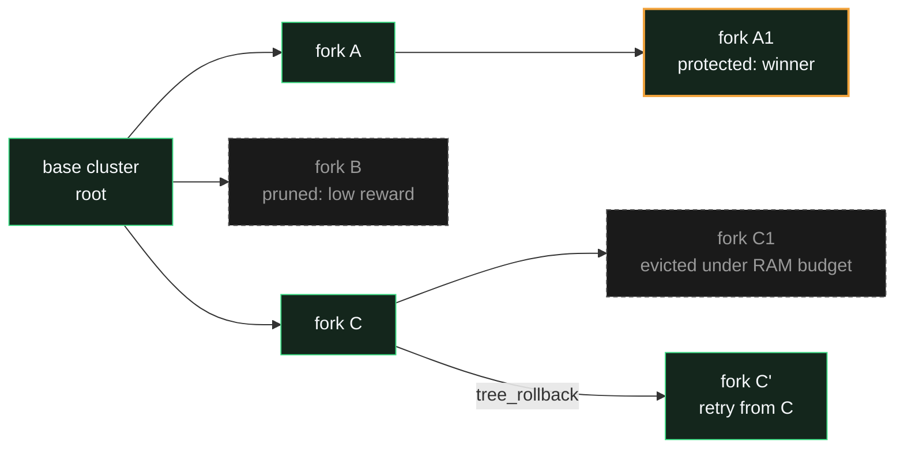

<h1 align="center">k7d</h1>

<p align="center">
  <b>Fork a live Kubernetes cluster.<br/>
  Two clocks: ~105&nbsp;ms (minimal CI guest) and ~1.1&nbsp;s (Ubuntu k3s+Cilium+Tetragon).</b>
</p>

<p align="center">
  <a href="https://github.com/Katakate/k7d/stargazers"></a>
  <a href="https://docs.katakate.org">
    
  </a>
  <a href="https://deepwiki.com/Katakate/k7d"></a>
  <a href="LICENSE"></a>
  
  <a href="#formal-verification"></a>
  <a href="https://beci.me/blog"></a>
</p>

<p align="center">
  
</p>

<p align="center">
  <a href="LATENCY_BUDGETS.md"></a>
  <a href="LATENCY_BUDGETS.md"></a>
  <a href="LATENCY_BUDGETS.md"></a>
  <a href="docs/assets/k7d-mcp-demo.mp4"></a>
  <a href="docs/assets/k7d-tree-view.mp4"></a>
  <a href="docs/assets/k7d-dormant-fork.mp4"></a>
  <a href="docs/assets/k7d-dilated-tree.mp4"></a>
  <a href="docs/demo/README.md"></a>
</p>



<p align="center"><sub>Three copies of a running 3-node cluster. Nothing inside rebooted; the copies pay for the pages they change, not for the base.</sub></p>

<p align="center">
  
</p>
<p align="center"><sub>Recorded in real time. Guests run at ×8 (<code>dilation: 8</code>); fork latency chips are wall-clock. Only waiting compresses — see <a href="#time-warp-only-waiting-is-compressible">Time warp</a>.</sub></p>

RL training and agent evals whose environments are **Kubernetes** - 
clusters, charts, in-cluster workloads - need thousands of isolated,
resettable worlds. Not one sandbox, and not a cold `kind` cluster per
trial. Booting a fresh Kubernetes cluster takes ~30&nbsp;s and full RAM
per copy. k7d boots it **once**, then forks the live cluster.
Two clocks, always together: **~105&nbsp;ms** for the minimal CI guest
(test-enforced 1&nbsp;s budget) and **~1.1&nbsp;s** for Ubuntu
k3s+Cilium+Tetragon (48&nbsp;s source bring-up). Forks share memory
until they diverge, so 50 CI-guest copies cost dirty pages, not
50&nbsp;× full guest RAM.

The same engine is also a great **fork-first VMM** when your unit is a
single VM sandbox (including docker-in-VM): blazing-fast warm forks with
faithful snapshotting of memory, disk, processes, and networking. For
running that at scale - Kubernetes orchestrating your sandboxes, plus a
CLI / API / Python SDK for agents - see the sibling project
**[Katakate k7](https://github.com/Katakate/k7)**.

> <b>100% open‑source</b> (Apache‑2.0). For technical support, write us at: hi@katakate.org

## Why k7d

- ⚡ **Fork a running Kubernetes cluster** — two clocks: **~105&nbsp;ms**
  (minimal CI guest, 1&nbsp;s test-enforced budget) and **~1.1&nbsp;s**
  (Ubuntu k3s+Cilium+Tetragon, 48&nbsp;s source bring-up). Pack **50
  CI-guest copies on one 64&nbsp;GB box**. Cold-booting a fresh cluster
  takes ~30&nbsp;s and a full RAM bill per copy; k7d boots once, then
  copies share memory until they diverge.
- 🔁 **The cluster keeps running after the fork** - no agent restarts,
  no broken TLS, no "please wait while Kubernetes comes back." Each
  copy looks identical to the original from the inside.
- 🌲 **Built for AI agents that explore many worlds** - fork a branch,
  try something, keep the winners, throw away the losers. The agent
  decides what to keep; k7d enforces RAM and disk budgets so the tree
  doesn't eat the machine.
- ⏩ **k7d owns the guest clock** - an episode that is mostly *waiting*
  (probe periods, backoffs, reconcile ticks) does not have to wait in
  wall time. Lockstep clock jumps compress an 8.7-minute guest-time
  episode **1.83×** with zero fidelity delta; the carried KVM dilation
  patch runs the guests at **8× wall** (522 s → 79 s). Only waiting is
  compressible; compute stays real. Details [below](#time-warp-only-waiting-is-compressible).
- 🧊 **Also a blazing-fast VM-sandbox VMM** - warm-fork a single guest
  in ~5&nbsp;ms with faithful memory / disk / process / network state.
  Ideal for docker-in-VM and any workload that needs resettable
  isolated machines, not only whole k8s clusters. Pair with
  [Katakate/k7](https://github.com/Katakate/k7) when you want k8s
  orchestration + Python SDKs on top.
- 🔬 **We use formal methods where they pay off** - [Kani](https://model-checking.github.io/kani/)
  on selected `unsafe` / arithmetic paths, and
  [Aeneas](https://aeneasverif.github.io/)→Lean on the tree
  budget/eviction model. Not a claim that everything is proven - 
  details [below](#formal-verification).
- 🪶 **≤30k lines of Rust for the VMM + shim** - small enough to read
  and audit. Deliberately not a kitchen-sink VMM.
- ✅ **Every number here is a CI assertion** - not a one-off benchmark
  paste. If a latency claim drifts, a test fails. Methodology:
  [the benchmark write-up](docs/blog/2026-08-07-k7d-cluster-fork-benchmark.md).

## Quickstart

You need a Linux **amd64 / x86_64** host with KVM (`/dev/kvm` present) - 
same ISA (`amd64` is the Debian name; tarballs use `x86_64`). No arm64
build yet. Five minutes, from a clone or a clean box:

```bash
git clone https://github.com/Katakate/k7d && cd k7d
sudo ./scripts/quickstart.sh
```

That doctor-checks `/dev/kvm`, `/dev/vhost-vsock`, `/dev/net/tun`, and
cgroup v2; fetches the release tarball + guest artifacts if they are
not already here; starts `k7d`; boots a busybox 3-node tree; forks 4
branches; and prints wall-clocks next to both rows of the two-clocks
table. `k7d doctor` and `k7d quickstart` are the same verbs on an
already-installed binary.

```bash
k7d doctor                 # host checks; does not start a daemon
k7d quickstart             # 3-node busybox + 4 forks (daemon must be up)
```

To build from source instead: Rust + Docker, then `make release`
(`k7d-v*-x86_64-linux.tar.gz` + `install.sh`). The older
`examples/cluster-tree-search` demo is still there
(`python3 run_demo.py --mode busybox --branches 4`). To put real
Kubernetes pods *inside* those VMs (`runtimeClassName: k7`), see
[`HACKING.md`](HACKING.md). Full docs (API reference, installers) will
ship separately - this README is the product pitch + getting started.

## A frontier agent with a fork button

<p align="center">
  <a href="docs/assets/k7d-mcp-demo.mp4"></a>
  <a href="docs/demo/README.md"></a>
</p>

<p align="center">
  
</p>
<p align="center"><sub>Second wave: one copy is about to get wrecked on purpose. 21 / 24 VMs. (<a href="docs/assets/k7d-mcp-demo-fast.gif">whole run at 7×</a> · <a href="docs/assets/k7d-tree-view.mp4">the same incident seen from the tree</a> · <a href="docs/assets/k7d-tree-depth3.mp4">a depth-3 tree, scripted</a>)</sub></p>

Someone planted a miner in a Deployment that looks like a helper.
The real app (`k7-victim`) is fine. Kimi K3 does not touch
production first - it clones the cluster three ways and tries delete,
scale-to-zero, and “just watch.” The miner comes back every time.
So it forks *again* from the copy that already knows delete is a lie.
One of those labs restarts k3s to catch the respawner and is left
broken on purpose. No rollback. Another hangs an admission lock on
the name `node-agent`; recreate comes back denied. Only that pair of
moves is replayed on the source. Soak: still gone. Victim 2/2.
Tetragon clean.
[The story](docs/demo/README.md) ·
[Video](docs/assets/k7d-mcp-demo.mp4) ·
[JSONL](docs/assets/k7d-mcp-demo.jsonl).
Dashboard: [`examples/k7view/`](examples/k7view/).
Reproduce on a KVM box: `sudo make helm-pin` (Cilium/Tetragon
helm v3.16.4), then [`examples/k7d-mcp/`](examples/k7d-mcp/)
and [`gym/`](gym/). First Ubuntu image:
`guest/ubuntu/build-node-image.sh`.

## Using k7d for GRPO / agent tree search

If you already have Kubernetes tasks or scenarios (a Helm chart, a
set of YAML manifests, an eval harness that talks to a kube-apiserver),
the shape is:

1. **Boot the scenario once** - bring up your cluster (or adopt a
   running one that k7d already hosts) and wait until it is in the
   state you want every rollout to start from.
2. **Root a tree at that checkpoint.**
3. **For each GRPO group (or tree-search step):**
   `fork_batch(N)` → run your N policies against the N copies → score
   → `protect` the winners, `prune` the losers → let the daemon
   `auto_evict` under your RAM/disk budget.
4. **Roll forward** from a protected winner when you want the next
   generation to start from a better state, or `rollback` to an
   earlier node when you don't.



<p align="center"><sub>Orange: yours. Green: k7d verbs. The trainer owns rewards and policy; the daemon owns environments and budgets.</sub></p>

### Why byte-identical starts matter for GRPO

GRPO (and most group-relative methods) compare rewards *within a
group*. If member A starts from a colder cache, a different etcd
revision, or a half-ready Deployment than member B, the reward gap is
noise, not signal. A k7d fork is a copy of the live machine - same
memory, same disk, same in-cluster TLS sessions, same kube-apiserver
state. Every member of the group begins from a **byte-identical**
world, then diverges only because of what your policy did.

That is the difference between "we reset the env" and "we cloned the
universe."

### How your agent talks to the tree

Your training loop owns rewards and policy. k7d owns environments and
budgets. The agent talks JSON-lines over a Unix socket
(`/run/k7d/k7d.sock`). The verbs you actually need:

| You want to… | Call |
|---|---|
| Start from a warm VM or live cluster | `tree_create` / `tree_create_cluster` / `tree_adopt_cluster` |
| Open N parallel rollouts from one checkpoint | `tree_fork_batch` |
| Try again from an earlier node without destroying it | `tree_rollback` |
| Pin a winner so budget pressure can't kill it | `tree_protect` |
| Drop a losing subtree | `tree_prune` |
| Tear the tree down (stops guests; does not unlink caller disks) | `tree_drop` |
| Enforce RAM/disk caps now | `tree_auto_evict` |
| Discover sandbox / standalone `fork_vm` guests | `list_vms` / `vm_status` |
| Discover tree members and their CIDs | `tree_list` / `tree_nodes` (`live_guest_cids`) |

`tree_adopt_cluster` removes the member ids from `vms`. `stop_vm` on those ids then errors (`was adopted into tree …; use tree_prune / tree_drop`) and does not free tree disks. `tree_prune` of the root (a child prune does not) and `tree_drop` stop the guests and release the broker pins for those adopted ids (`K7D_PRIVSEP=on`). Caller-supplied `block_devices` stay the caller's to unlink after that.

`list_vms` is only that sandbox registry. Adopted members and `tree_create*` / `tree_fork*` guests do not appear there — do not fold them into `list_vms` and then `stop_vm` everything listed. Guest exec is vsock to a CID (the daemon does not proxy the agent): keep `TreeForked.guest_cids` (or `agent_endpoints` for Firecracker) from the fork reply, or re-read `tree_nodes.live_guest_cids[node_id]`. The old `create_vm` `vm_id` does not reach a tree fork. `dump_serial` after a fork reads a fresh COM1 buffer and starts empty; dump the source before `tree_fork` if you need pre-fork console, or pass the new CID / `vm_id: "{tree_id}/{node_id}"`. [`examples/k7d-mcp/`](examples/k7d-mcp/) `branch_exec` is the in-tree pattern (CID from `tree_nodes`, not `list_vms`).

A thin Python client that covers exactly this loop lives in
[`examples/cluster-tree-search/`](examples/cluster-tree-search/). Treat
it as the template for wiring your GRPO trainer - not as a finished
SDK. To *watch* a live tree (git-graph, fork latency, protect/evict
notes, per-branch traces) run [`examples/k7view/`](examples/k7view/)
on the node - k7d stays machine-first; k7d-view is the observer. The
full API reference will live in the docs site.

## How it works (the non-obvious bits)

You do not need to be a VMM engineer to use k7d. You do need to know
*why* a sub-second cluster fork is even possible, because that is the
product. Two clocks: ~105&nbsp;ms on the minimal CI guest, ~1.1&nbsp;s
on Ubuntu k3s+Cilium+Tetragon.



A fork, end to end, is a short critical section on the source:



**Memory is shared until someone writes.** Guest RAM lives in one file.
A fork pauses the source for a moment, notes which pages changed since
the last checkpoint, maps the child's memory as a copy-on-write view of
the parent's, and copies only those dirty pages. Everything else is
shared. That is why 50 forks of a cluster fit in 64&nbsp;GB: you pay for
divergence, not for the base.

**The cluster does not reboot because the network lies consistently.**
Each cluster lives on its own private Linux bridge. A fork gets a
*new* bridge with the *same* guest IPs and MAC addresses as the source.
From inside the guest, nothing moved - same addresses, same ARP cache,
same TLS certs, same established TCP - so kubelet, the CNI, and the
control plane keep running. Separate bridges mean forks cannot see each
other. Without this, every fork would force a kubelet restart and a
~1-2&nbsp;s agent restart per node, and the ~105&nbsp;ms / ~1.1&nbsp;s
claims would be impossible.

**Forks live in a tree the daemon manages under budget:**



Any live node is a fork source, so trees go as deep as the search
does (depth 3 in the [scripted clip](docs/assets/k7d-tree-depth3.mp4);
the daemon reports real parent edges, the UI does not invent them).

### Three tricks that had to be right

These are the kinds of bugs that silently break "byte-identical."
[`CHALLENGES.md`](CHALLENGES.md) has nearly 200 of them; these three
are the headline ones:

1. **Device writes are invisible to the hypervisor's dirty log.**
   Block devices in k7d write guest memory from userspace. The
   hypervisor only sees CPU writes - so a fork taken after disk I/O
   would resurrect *pre-I/O* bytes on those pages (silent corruption).
   Fix: track device dirty pages ourselves and merge them into the
   fork bitmap, and drain in-flight I/O before the bitmap is read.
   ([CHALLENGES.md #43](CHALLENGES.md))
2. **A restored guest with a blank timer chip freezes time.** After
   fork, the interval timer was left unprogrammed - no timer
   interrupts, `CLOCK_REALTIME` stuck, and Kubernetes quietly parks.
   Fix: re-arm the timer (and reset the paravirtual clock) on every
   restore. ([CHALLENGES.md #40](CHALLENGES.md))
3. **Identical IPs only work if the L2 domains are separate.** Replay
   the source's addresses onto a fresh bridge per fork. Same view
   from inside; no conflicts across forks. That is the zero-restart
   trick above.

## Time warp: only waiting is compressible

Fork removes the cost of *starting* an episode. Most of what is left
in a Kubernetes episode is waiting - readiness probes, CrashLoopBackOff
timers, controller reconcile ticks. A 3-node Ubuntu cluster is all-idle
~70% of the time and only 7-10% of its vCPUs are awake. k7d already
owns the guest clock end to end (`kvm-clock`, no RTC, no NTP client,
`KVM_SET_CLOCK` on every restore), so the same pause that makes a fork
correct can also move every member's clock by the same delta:

| Mechanism | What it does | 8.7 min guest-time episode, 3-node k3s | Fidelity cost |
|---|---|---|---|
| **Stock clock** | — | **522 s** wall | — |
| **Lockstep jump** (`auto-warp`, no kernel patch) | When every vCPU is idle, pause, add the same δ to kvmclock + every TSC offset up to the next armed timer, resume. 0.2 ms pause, ~20 Hz | **286 s (1.83×)** | **zero** - same probe failures, restarts, leases, splats as stock |
| **Continuous dilation ×N** (carried ~200-line KVM patch) | Guest clocks run N× wall; every clock the guest can read agrees. Set per VM, changed live on a paused cluster in ~0.4 ms, inherited or overridden on fork | **79 s (8.00×)** at N=8; exactly N through 16, knee at N=12 | real, bounded: work does not dilate, so guest-visible `fsync` 2.3 → 14 ms, pod RTT 0.69 → 0.92 ms, a guest-paced churn loop does 37 rounds instead of 86 |
| Both | — | 76 s (8.11×) | the two do not stack: dilation consumes the idle windows jumps need |

The gym exposes this as `autowarp_mode` per lease: `off` / `jump` /
`micro` / `dilate`. Forks of a dilated cluster land on the source's
clock and can be born at a different factor (`dilation` on
`tree_fork_batch`), so one ×1 source tree serves every mode. Forward
only, lockstep only, whole-cluster pause or nothing - a declined warp
is always correct. Reproduce with `make remote-warp-bench` and
`make remote-dilation-install`.

## Measured numbers

On one bare-metal box (~€40/month bare-metal: Ryzen 5 3600, 6 cores,
64&nbsp;GiB, NVMe):

| Guest | Fork | Bring-up | Enforced budget |
|---|---|---|---|
| **Minimal CI guest** (busybox / inner-k3s, under API churn) | **~105 ms** | already warm | 1 s |
| **Ubuntu k3s+Cilium+Tetragon** (gym / agent path) | **~1.1 s/fork** | **48 s** source | gym path (not the 1 s CI budget) |
| Warm single-VM fork (&lt;25% dirty) | ~5 ms | — | 50 ms |
| **50 × 3-VM** CI-guest cluster-tree forks (shared pause) | **~4.1 s** (~82 ms/cluster) | already warm | 20 s |
| VM boot → guest agent ready (cold, CI guest) | ~163 ms | — | 250 ms |

Every row is an integration-test assertion
([`LATENCY_BUDGETS.md`](LATENCY_BUDGETS.md)). Full methodology:
[the benchmark write-up](docs/blog/2026-08-07-k7d-cluster-fork-benchmark.md).

## Kubernetes feature support

Two layers - most RL users only care about the first.

### Inside a forked cluster (your GRPO scenario)

This is the k3s that lives *inside* the VMs you fork. The fork engine
is **N-node** (`tree_create_cluster(vm_count)` / adopt any live set) - 
there is no hard-coded 3. The CI fixture that proves the headline
numbers is a 3-node control plane with flannel + kube-proxy and a real
in-cluster Deployment. That **default profile** keeps stock k3s add-ons
off so the lean path stays lean; each add-on below is an opt-in
profile on the same switchboard, with its own proving test. Status
below mixes “API can do it” with “fixture exercises it.”

| Feature | Status | Notes |
|---|---|---|
| k3s control plane (server + agents) | ✅ Today | Fixture proves 3 Ready nodes; TLS / node IPs survive fork |
| **N-node clusters** (5, 20, …) | ✅ Today | Same fork path for any `vm_count`; limited by **host RAM**, not by the API. At ~3.2 GiB/node, a 20-node base alone is ~64 GiB - shrink guest memory (or use a bigger box) and it forks like the 3-node case |
| Flannel (`host-gw`) | ✅ Today | Shared L2 between member VMs |
| kube-proxy (ClusterIP by IP) | ✅ Today | |
| Deployments / ReplicaSets / Pods | ✅ Today | e.g. `inner-load` Ready on source *and* fork |
| ConfigMaps / Secrets (as in-cluster objects) | ✅ Today | Exercised under churn before fork |
| overlayfs snapshotter (guest containerd) | ✅ Today | |
| CoreDNS | ✅ Today | Fixture proves DNS on all members across a warm fork - `test_inner_k3s_coredns_dns_fork` |
| Traefik / Ingress | ✅ Today | HTTP through an Ingress on source and fork - `test_inner_k3s_ingress_fork` |
| ServiceLB | ✅ Today | Traefik Service reports guest IPs as LB ingress; same proving test as Ingress - `test_inner_k3s_ingress_fork` |
| metrics-server | ✅ Today | `kubectl top` / `metrics.k8s.io` Available on all three nodes across a warm fork - `test_inner_k3s_metrics_server_fork` |
| `local-path` / in-cluster PVC provisioning | ✅ Today | Same bytes on source and fork, then independent divergence - `test_inner_k3s_local_path_pvc_fork` |
| NetworkPolicy | ✅ Today | Default-deny + allow enforced on source and fork - `test_inner_k3s_network_policy_fork`. Guest kernel needs ipset + `xt_set`, xt NFLOG/limit, and `nft_log`/`nft_limit` ([CHALLENGES.md #93](CHALLENGES.md)) |
| HPA | ✅ Today | CPU-metrics scale-up on source and fork; observed utilization diverges after a fork-only load change - `test_inner_k3s_hpa_scale_fork` |
| Embedded etcd datastore | ✅ Today | Single-member `--cluster-init` WAL and writes survive a warm fork; per-bridge writes stay isolated - `test_inner_k3s_etcd_datastore_fork` |
| ArgoCD core GitOps | ✅ Today | In-cluster `git://`; Application Synced/Healthy + `reconciledAt` on both bridges; fork-only commit syncs only on the fork - `test_inner_k3s_argocd_gitops_fork`. application-controller shards and does not hold a coordination Lease ([CHALLENGES.md #96](CHALLENGES.md)) |
| Mock GPU + DCGM fixture | ✅ Today | Ubuntu k3s advertises `nvidia.com/gpu` from a real kubelet device plugin; a pause pod requesting one GPU becomes Running and free GPUs drop (pod requests; `status.allocatable` stays at Capacity); a dcgm-exporter-shaped scrape on :9400 survives a warm fork. **Mock only — not CUDA / not DeepSpeed.** `test_ubuntu_ml_mocks_gpu_dcgm_fork` |
| Configurable fake GPU count | ✅ Today | `FAKE_GPU_COUNT` (default 2) on the fixture DaemonSet; 8 GPUs/node so an 8-GPU pod fits and a second stays Pending once leftover nodes are 1-GPU fragments. **Mock only — not CUDA.** `test_ubuntu_ml_gpu_count_eight_fits_and_fragments` |
| Fake GPU `Allocate` device IDs | ✅ Today | Device plugin `Allocate` sets `NVIDIA_VISIBLE_DEVICES` to the kubelet-assigned `fake-gpu-N` IDs; a 2-GPU pod sees exactly those two and they match the kubelet pod-resources API. **Mock only — not CUDA / not `/dev/nvidia*`.** `test_ubuntu_ml_gpu_allocate_two_ids_match_pod_resources` |
| Per-pod fake DCGM | ✅ Today | DaemonSet serves one `DCGM_FI_DEV_*` series per `fake-gpu-N` with `pod` / `namespace` / `container` from the kubelet pod-resources API; labels drop when the pod is deleted. Defaults `DCGM_FI_DEV_GPU_UTIL=42` and `DCGM_FI_DEV_FB_USED=1024` (env `FAKE_DCGM_GPU_UTIL` / `FAKE_DCGM_FB_USED`, or pod annotations `k7d.katakate.org/fake-dcgm-gpu-util` and `k7d.katakate.org/fake-dcgm-fb-used`). Scrape survives a warm fork. **Mock only — not NVML / not DCGM.** `test_ubuntu_ml_dcgm_per_pod` |
| Fake GPU flavors + topology | ✅ Today | Configurable product and block/rack labels (`FAKE_GPU_PRODUCT`, topology env, or per-node `fake-gpu-identity` ConfigMap). Kueue ResourceFlavors `fake-h100` / `fake-l40s` route Jobs onto matching nodes; a required-block Topology-Aware Scheduling Job lands in one fake block. **Mock only — not CUDA, not a batch scheduler.** `test_ubuntu_ml_gpu_flavors` |
| JobSet on mock GPUs | ✅ Today | Digest-pinned JobSet v0.12.0; a 2-worker JobSet each requesting `nvidia.com/gpu: 1` rendezvous over cluster DNS and Completes a CPU/Gloo-shaped script; an in-flight JobSet plus Complete survive a warm fork. **JobSet on mocks — not CUDA / not DeepSpeed.** `test_ubuntu_ml_jobset_gpu_fork` |
| Soft-RoCE (`rdma_rxe`) | ✅ Today | Ubuntu nodes create `rxe0` on guest `eth0`; `rdma link` + `ibv_devinfo` on ≥2 nodes survive a warm fork; a child-only `rxe1` stays invisible on the source. **Soft-RoCE — not NCCL / not GPUDirect.** `test_ubuntu_ml_rdma_soft_roce_fork` |
| KubeRay on mock GPUs | ✅ Today | Digest-pinned KubeRay v1.7.0; a CPU-head RayCluster plus a worker requesting `nvidia.com/gpu: 1` schedules on the mock and survives a warm fork; a child-only RayCluster stays invisible on the source. **KubeRay on mocks — not CUDA.** Operand is busybox. `test_ubuntu_ml_kuberay_gpu_fork` |
| RayJob on mock GPUs (CPU Ray) | ✅ Today | Digest-pinned `rayproject/ray:2.47.1-py311` on 8 GiB / 4 vCPU Ubuntu nodes; a RayJob whose worker requests `nvidia.com/gpu: 1` reaches SUCCEEDED. `ray status` reports **`0.0/1.0 GPU`** both with `rayStartParams.num-gpus: "1"` and when that param is omitted — KubeRay injects `--num-gpus` from the `nvidia.com/gpu` request (CHALLENGES #269). No NVML; Ray sees a count, not a device. **Mock only — not CUDA / not Ray GPU placement-group hardware.** `test_ubuntu_ml_rayjob_gpu_succeeded` |
| TrainJob on mock GPUs | ✅ Today | Digest-pinned Kubeflow Trainer v2.2.1 + JobSet v0.12.0; a 2-worker TrainJob on a custom busybox TrainingRuntime each requesting `nvidia.com/gpu: 1` stays Running and survives a warm fork; a child-only TrainJob stays invisible on the source. **TrainJob on mocks — not CUDA / not a PyTorch runtime.** `test_ubuntu_ml_trainjob_gpu_fork` |
| Kueue on mock GPUs | ✅ Today | Digest-pinned Kueue v0.19.2; a ClusterQueue whose `nvidia.com/gpu` quota is 1 admits one busybox Job and holds the second Pending; queues + split survive a warm fork; a child-only LocalQueue stays invisible on the source. **Kueue on mocks — not a batch scheduler claim.** `test_ubuntu_ml_kueue_gpu_fork` |
| Cilium (eBPF CNI, kube-proxy replacement) | ✅ Today | Inner-k3s native-routing + CiliumNetworkPolicy across a warm fork — `test_inner_k3s_cilium_datapath_fork`. Ubuntu gym path: Helm Cilium 1.16.10, same datapath — `test_ubuntu_cilium_datapath_fork` |
| Tetragon | ✅ Today | Ubuntu Cilium cluster, Helm Tetragon 1.7.0; fork-and-diff of the event stream — `test_ubuntu_tetragon_fork_event_diff` |
| Longhorn (RWO / RWX CSI) | ✅ Today | Ubuntu Cilium cluster, Helm Longhorn 1.12.1; RWO + RWX PVCs and their markers survive a warm fork as reflink-CoW data disks — `test_ubuntu_longhorn_fork_volumes`. Not a fixture on the minimal CI guest |
| Nested `hostNetwork` pods | ❌ Not today | Known failure mode in the guest |

Need CoreDNS + Ingress on one cluster? Flip the profile flags - the
switchboard is configuration, not a redesign. Same for a larger CI
fixture: wiring 20 nodes is configuration + RAM, not a new fork
feature.

### Host RuntimeClass (pods *as* k7d VMs)

This is the outer layer: kubectl on the host schedules pods into k7d
microVMs via `runtimeClassName: k7` (native) or `k7-fc` (Firecracker).
Relevant if you also want single-VM sandboxes, not only whole-cluster
forks.
`examples/agent-sandbox/` runs
[agent-sandbox](https://github.com/kubernetes-sigs/agent-sandbox) on top.

| Feature | Status | Notes |
|---|---|---|
| `runtimeClassName: k7` (CRI / containerd shim) | ✅ Today | Native in-process VMM |
| `runtimeClassName: k7-fc` | ✅ Today | Same pods, stock Firecracker + jailer. [k7d vs k7d-fc](#two-backends-k7d-vs-k7d-fc) |
| `kubectl logs` / `exec` / `exec -it` (PTY) | ✅ Today | Incl. resize, Ctrl-C, detach |
| Pod IP, Services, DNS, egress | ✅ Today | Host CNI dataplane |
| ConfigMap / Secret / projected / downwardAPI / emptyDir | ✅ Today | |
| hostPath, local-path PVC, k7d RWO disk volumes | ✅ Today | hostPath is native-only (`k7-fc` has no virtiofs) |
| Memory / CPU limits; multi-container / sidecars | ✅ Today | |
| Warm fork of the pod VM | ✅ Today | Snapshot-tree fork of that sandbox. Whole-cluster fork is the daemon tree API (bare VMs), not a kubectl feature — [k7d vs k7d-fc](#two-backends-k7d-vs-k7d-fc) |
| Init containers; natural exit / `restartPolicy` | ✅ Today | Multi-container pods |
| Multi-vCPU guests (`cpu: "2"+`) | ✅ Today | From pod CPU limits; fork/snapshot parity |
| NetworkPolicy on the pod IP | ✅ Today | k3s kube-router, same verdicts as runc for egress ipBlocks and ingress podSelector — `test_agent_sandbox` V6. Other CNIs not measured on the host RuntimeClass |
| agent-sandbox `Sandbox` / warm pool / claim | ✅ Today | v1.0.5 on `k7` and `k7-fc`, incl. SDK, port-forward, Docker-in-VM — `examples/agent-sandbox/`, `test_agent_sandbox`. Kubelet volume updates (token rotation) do not reach the guest |
| `hostNetwork`, IPv6, arbitrary CSI / RWX | 🔜 Later | Host RuntimeClass only — in-cluster Cilium NetworkPolicy and Longhorn RWX are the rows above |
| Cross-node fork | 🔮 Later | Host-local trees today |

## Two backends: k7d vs k7d-fc

One daemon, two VMMs. `backend` on `create_vm` picks which process
owns the KVM fd. A tree is one backend, never mixed.

That is **not** “bare VM vs RuntimeClass.” Both surfaces run on either
VMM:

- **Bare VM / tree / gym** — `create_vm` / `tree_create` /
  `tree_fork_batch` on `/run/k7d/k7d.sock`. Cluster fork, the two
  clocks in the hero (~105&nbsp;ms CI guest / ~1.1&nbsp;s Ubuntu
  k3s), time warp, and the gym all live here.
- **Kubernetes RuntimeClass pods** — kubectl on the *host* cluster
  schedules a pod into a microVM. `runtimeClassName` is only the
  kubectl way to set `backend`.

| | **native** (`k7d`) | **firecracker** (`k7d-fc`) |
|---|---|---|
| Pick on the socket | `backend: native` (default) | `backend: firecracker` |
| Kubernetes RuntimeClass | `runtimeClassName: k7` | `runtimeClassName: k7-fc` |
| VMM | k7d's in-process rust-vmm | stock Firecracker + jailer |
| Per-VM jail (own uid, chroot, seccomp) | ❌ | ✅ |
| Independently audited VMM | ❌ | ✅ |
| Privilege split (root node broker / uid-`k7d` VM broker) | ✅ same daemon | ✅ same daemon |
| virtiofs | ✅ | ❌ |
| Built for | RL, gym, fleets you control | multi-tenant / hostile guests |

**Bare VM / tree / gym** (daemon API — not a Kubernetes RuntimeClass):

| | native | firecracker |
|---|---|---|
| Warm VM fork | ✅ **~5–50 ms** | ✅ **~76–140 ms** / child |
| Whole-cluster fork | ✅ | ✅ |
| Snapshot tree / warm pool | ✅ | ✅ |
| Guest time warp / ×N dilation | ✅ | ❌ |
| Lockstep cluster pause | ✅ | ⚠️ parallel pause (µs skew) |

**Kubernetes RuntimeClass pods** (host `runtimeClassName` — not the gym):

| | `k7` (native) | `k7-fc` (firecracker) |
|---|---|---|
| `kubectl logs` / `exec` | ✅ | ✅ |
| hostPath (virtiofs) | ✅ | ❌ |
| docker-in-guest | ✅ | ✅ |

Privilege separation is the daemon, not a third backend: one node
broker (root, no listening socket) plus one VM broker (uid `k7d`,
empty caps) for the whole node. The shipped unit sets
`K7D_PRIVSEP=on`; `off` is the escape hatch (one root process).
Native vCPU threads and virtio emulation run *in* the VM broker;
Firecracker vCPUs run in the jailer jail and the VM broker only
speaks the API. A VM-broker crash kills native VMs (they are
threads); standalone Firecracker pods can survive it
(`K7D_VM_BROKER_RESTART`, ships off). `k7d doctor` reports
`privsep:`.

Native is the default and the 250&nbsp;ms latency suite. Use
Firecracker when the guest might try to escape — especially
multi-tenant `--docker`. Asking for virtiofs or time warp on the
Firecracker backend fails Create loudly; nothing is silently dropped.
Details: [Backends](https://docs.katakate.org/k7d/concepts/backends),
[`SECURITY.md` privilege split](SECURITY.md#privilege-separation),
[Firecracker profile](SECURITY.md#firecracker-profile-runtimeclassname-k7-fc).

## Why not Firecracker / Kata / E2B-style sandboxes?

| | Firecracker | Kata | CubeSandbox / E2B-style | forkd | **k7d** |
|---|---|---|---|---|---|
| Warm fork of a **running** VM | snapshot → restore | no | snapshot + N restores (~220 ms) | Firecracker + MAP_PRIVATE (~56–150 ms BRANCH) | live copy-on-write fork (**~5 ms** native VMM; ~76–140 ms Firecracker backend) |
| Snapshot tree (fork / rollback / protect / budget) | no | no | SDK around sandboxes | snapshot tag + branch | yes - daemon API |
| Forks a **whole k8s cluster** | no | no | no | no (one sandbox VM) | **yes** (~105 ms CI guest / ~1.1 s Ubuntu) |
| Per-VM jailer | yes | yes | process-per-sandbox | process-per-child, **no jailer** | native VMM ❌ / Firecracker backend ✅ |
| Runs as a Kubernetes RuntimeClass | via FC-containerd | yes | no | no | yes (`k7` / `k7-fc`) |
| Guest time warp (lockstep jump / ×N dilation) | no | no | no | no | native VMM **yes**; Firecracker backend ❌ |
| Formal methods | audit/fuzz culture | - | - | - | Kani + Aeneas on selected paths (memory math, tree budgets) |

They fork a sandbox. k7d forks a **VM or an entire cluster** (daemon
tree API, either VMM). Deliberately not E2B-API compatible - different
job. CubeSandbox is the honest nearest neighbor on density and
packaging. forkd is the honest nearest neighbor on the *sandbox*
side — see below.

### k7d-fc vs forkd

Both wrap Firecracker and CoW-fork guest RAM. forkd is a sandbox
fan-out. `k7d-fc` is k7d's tree / cluster / RuntimeClass product with
Firecracker swapped in as the VMM ([forkd](https://github.com/deeplethe/forkd)).

| | **k7d-fc** | **forkd** |
|---|---|---|
| Stock Firecracker (no patch) | ✅ | ❌ vendored FC for live BRANCH (`MAP_SHARED` + UFFD) |
| Stock jailer (uid, chroot, seccomp) | ✅ always | ❌ drives the API socket; no jailer |
| Whole-cluster fork | ✅ | ❌ one sandbox VM |
| Snapshot tree / RAM+disk budget | ✅ daemon API | ⚠️ snapshot tag + branch |
| Kubernetes RuntimeClass | ✅ `k7-fc` | ❌ |
| Privilege-separated daemon | ✅ | ❌ |
| Warm fork of a running VM | ✅ **~76–140 ms** / child | ✅ **~56–150 ms** BRANCH |
| 100 children from one snapshot | ❌ jailer spawn per child | ✅ **~100 ms** (`mmap MAP_PRIVATE`) |
| Live BRANCH (source barely pauses) | ❌ Diff snapshot + `LoadSnapshot` | ✅ v0.4 UFFD-WP (needs the FC patch) |
| Guest time warp / ×N dilation | ❌ | ❌ |
| Built for | k7d tree + hostile guests | agent sandbox fan-out |

Native k7d (~5&nbsp;ms in-process fork) is a different mechanism —
do not compare that number to forkd. `k7d-fc` pays the jailer on
every child so a guest→VMM bug dies in the jail, not in a patched
VMM.

## Security model & limitations

- **Two backends, two isolation stories.** Native (`backend: native`)
  is one daemon address space: live copy-on-write fork requires parent
  and child memory to be mappings in the same process. Guest→host is
  still KVM; isolation *between sibling forks of the same tenant* is
  weaker than a jailed VMM. Firecracker (`backend: firecracker`,
  RuntimeClass `k7-fc` for pods) puts each VM in stock Firecracker
  under the stock jailer (own uid, chroot, seccomp). Native is for
  fleets you control (RL, gym); Firecracker is the multi-tenant /
  hostile-guest profile. See [k7d vs k7d-fc](#two-backends-k7d-vs-k7d-fc).
- **What survives a fork:** everything inside the forked set - 
  in-cluster TLS, established TCP between member VMs, disk state.
  Guest clocks are reset so time does not jump backwards.
- **What doesn't:** TCP to the outside world (the far end never
  forked). Forks keep their in-cluster addresses; only the
  host-facing identity is new.
- **Single host, x86_64 Linux + KVM only.** Cross-node fork is on the
  roadmap. Does not build on macOS/Windows.
- **Young project.** ≤30k LOC for the VMM + shim, one primary test
  machine, no security audit yet. Small surface by design.

## Formal verification

Selected critical pieces are machine-checked - not the whole runtime:

| Tool | What it covers |
|---|---|
| [Kani](https://model-checking.github.io/kani/) | Bounded proofs over selected `unsafe` / address-arithmetic harnesses |
| [Aeneas](https://aeneasverif.github.io/) → Lean | Functional correctness of the snapshot-tree budget / LRU eviction model |

```bash
make kani                      # selected unsafe / arithmetic harnesses
make verif-gen verif-build     # regenerate Lean model + prove it
```

## Roadmap

- ✅ Warm single-VM fork, snapshot trees, budget eviction
- ✅ containerd shim + `runtimeClassName: k7` / `k7-fc`
- ✅ Live 3-node cluster fork — two clocks: ~105 ms CI guest / ~1.1 s Ubuntu k3s+Cilium+Tetragon
- ✅ Kani + Aeneas proofs on selected critical paths
- ✅ Guest time warp: lockstep jumps (1.83×, zero fidelity delta) and ×8 KVM dilation, fork-aware
- ✅ Prebuilt release tarball + `install.sh` (`make release`)
- 🔜 Config file (`/etc/k7d/config.toml`)
- 🔮 Cross-node fork

## License

Apache-2.0 - see [`LICENSE`](LICENSE).
