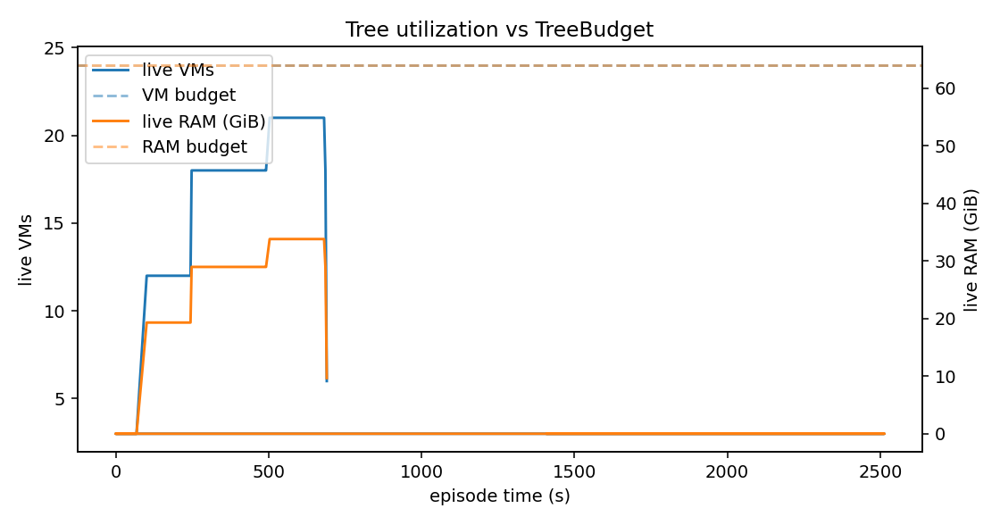
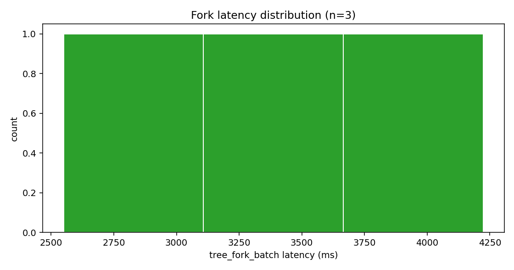
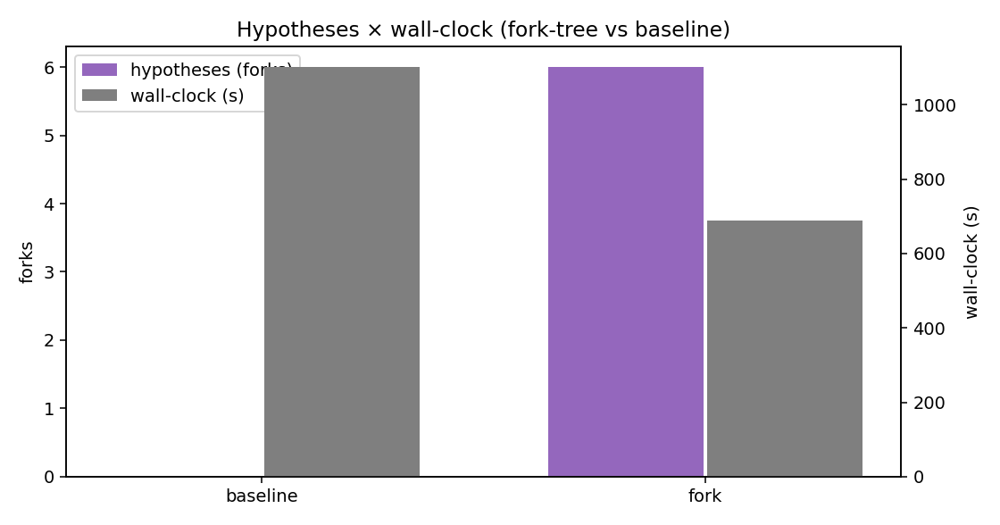

# I gave a frontier model a cluster and a fork button

A live 3-node Ubuntu Kubernetes cluster — Cilium, Tetragon, a victim
Deployment that is fine — has a miner in it. The miner's name is
`node-agent`. It looks like a helper. It hashes `/dev/zero` as
`/tmp/nodecheck`. What you cannot see from `kubectl get pods` is the
host-side respawner: a dormant systemd path unit that puts the miner
back whenever anyone deletes it.

The agent's tools are not kubectl-on-prod. It gets `fork_batch`,
`branch_exec`, `tetragon_diff`, `protect`, `prune`. A time machine.
It clones the whole cluster, tries destructive fixes in parallel
universes, scores each universe by diffing Tetragon event streams
against the source, and only then replays the winning command on
production.

That is the demo. The engine underneath is k7d: a purpose-built KVM
microVM daemon that warm-forks a *live* cluster. Two clocks, always
together:

| Guest | Fork | Bring-up |
|---|---|---|
| Minimal CI guest (busybox / inner-k3s) | **~105 ms** (1 s test-enforced budget) | already warm |
| Ubuntu k3s+Cilium+Tetragon | **~1.1 s/fork** | **48 s** source |

The 105 ms number is real. It is also the wrong number to put in a
headline by itself. The agent in the video is on the second row.

## The setup

k7d is a Rust VMM + a Unix-socket daemon. A cluster is a tree node.
A warm fork is CoW memory plus reflink disks. The daemon listens on
`/run/k7d/k7d.sock` and nowhere else — no TCP, no auth, no HTTP. The
MCP server (`examples/k7d-mcp/server.py`, stdio, ~120 lines) wraps
seven tree verbs and nothing else. If you want a dashboard, that is
k7view, a pure observer.

The agent is OpenAI Codex CLI (Apache-2.0) as the loop, pointed at
OpenRouter (`moonshotai/kimi-k3`) and at that MCP server. No agent
framework. No custom loop. A 100-line launcher
(`examples/k7d-mcp/agent_codex.py`) translates the harness MCP config
and runs `codex exec`.

The incident catalog is deliberately not told to the agent. The
flagship run is `relay`: a miner Deployment whose host reseed is a
dormant systemd path unit a pre-fork inspect battery cannot name.

## What actually happens (the video)

[Watch the run](../assets/k7d-mcp-demo.mp4) ·
[Watch the tree itself](../assets/k7d-tree-view.mp4) ·
[The story](../demo/README.md) ·
[JSONL](../assets/k7d-mcp-demo.jsonl)

Two cameras on the same class of run. The first video is the agent
transcript. The second is the k7view dashboard during another take
of the same incident: the orange shielded node is production, forks
appear in waves with fork latency on the edges, the budget gauge
climbs to 21 of 24 live VMs, pruned losers gray out, and the winner
gets a shield before its fix is replayed on the source. That take:
50 tool calls, 690 s, three `fork_batch` waves (4.2 s n=3, 3.4 s
n=2, 2.6 s n=1), all from the source
([its JSONL](../assets/k7d-tree-view.jsonl)). And because a fork of
a fork is the tree contract, not a slide: a
[30-second deterministic clip](../assets/k7d-tree-depth3.mp4) of the
dashboard forking each wave from the previous wave's winner —
root → child → grandchild → great-grandchild, real parent edges
from the daemon.

Incident fires. The agent inspects the source read-only. It does not
touch production first.

Wave 1: `fork_batch` n=3. Delete / scale-to-0 / host hunt. The RAM
gauge climbs. Those shallow fixes respawn — the miner is back in
about thirty seconds. A cleanup that "works" is not a fix. The first
universe taught that.

Wave 2: it forks *again*, from the wave-1 child that already knows
delete is a lie. Depth 2. Peak **21 of 24** live VMs. The
budget-pressure banner fires. One copy restarts k3s to catch the
respawner's handwriting and is left broken on purpose. No rollback.
Another hangs a CEL `ValidatingAdmissionPolicy` on the name
`node-agent`. Recreate comes back `denied`. The victim stays Ready.
A long soak: still gone.

Only then does it replay that pair of moves on `root`. Soak. Try to
see the miner come back. It does not. Tetragon of the source is
clean. `k7-victim` is 2/2.

First guesses die on copies. One copy is sacrificed to learn the
respawner's handwriting. The keeper is a door that stays shut.
Production only sees the door.

## Two clocks (read this before the plots)

The video is the Ubuntu gym path. The ~105 ms number from blog #6 is
the RuntimeClass / inner-k3s CI guest: a prepared CoW cluster-tree
fork under API churn, 1 s budget, enforced as a test. Different
guest, different path, different constraints.

| Guest | What it is | Fork | Bring-up | Where it is enforced |
|---|---|---|---|---|
| Minimal CI guest | tiny kernel + busybox / nested-runc inner-k3s | **~105 ms** | already warm | `FORK_INNER_K3S_CLUSTER_3VM` = 1 s |
| Ubuntu k3s+Cilium+Tetragon | the agent / RL-gym path | **~1.1 s/fork** | **48 s** source (cache hit) | measured on the gym path; episode time includes fault injection |

The agent runs paid the Ubuntu number: **4.4 s** for `fork_batch`
n=3 from the prepared root and **7.8 s** from a wave-1 child in the
transcript video; **4.2 s / 3.4 s / 2.6 s** for the three waves in
the tree-view take. That is dump-and-load of adopted Ubuntu guests,
not the sub-250 ms product path. Both clocks are true. Quoting only
the fast one is a lie of omission.

## The five plots

Rendered by `examples/k7d-mcp/plots.py` from the harness JSONL (every
MCP tool call logs one line: ts, tool, args, latency, usage, budget).
Both arms are the **same frontier model** (Codex CLI → kimi-k3) on
the same node, same `relay` incident: the fork arm is the tree-view
take above (`docs/assets/k7d-tree-view.jsonl`); the baseline arm is
that model with `fork_batch` and `rollback` refused by the harness —
it asked for both, got denied, and had to work on production.
"Destructive" is a keyword classifier over the raw commands
(`examples/k7d-mcp/mutation.py`), applied to both logs at render
time so the two arms are never scored by different rules.

### 1. Tree utilization vs budget



This is the "at the limit" story. Live VMs and RAM vs `TreeBudget`.
Fork waves are the steps up. Prune and evict are the drops. The
daemon, not the agent, owns the cap — the agent can ask for another
universe; the tree will refuse if the box is full. Peak on the
recorded run: **21 of 24** live VMs, ~33 GiB live RAM.

### 2. Fork latency



Honest numbers, Ubuntu gym path: three `fork_batch` waves in the
recorded run — **4.2 s** (n=3), **3.4 s** (n=2), **2.6 s** (n=1),
all from the live source. The earlier transcript-video run also
forked from a wave-1 child (**7.8 s**, depth 2). See the two-clocks
table. Do not compare these bars to the ~105 ms CI-guest row
without naming the guest.

### 3. Hypotheses tested vs wall-clock



The claim is not "faster kubectl." The claim is that tree search
beats serial trial-and-error on a world you are not allowed to
break. Fork arm: **50 tool calls, 690 s, 6 hypotheses** across
three waves — shallow deletes respawned on the copies, the
admission-policy fix held, and only that was replayed on `root`.
Baseline, same model, forks refused: **60 tool calls, 1102 s, 0
hypotheses** — it diagnosed carefully, then had no choice but to
run its experiments on production. Its own closing words: "fork-
first testing wasn't possible. I compensated by … a confirmation
probe (delete → measure respawn interval)" — that probe was a
delete on the live cluster.

### 4. Remediation blast radius


Mutating actions on forks vs on the live source, same model both
arms. Fork arm: **12 mutating commands on forks, 1 on production**
(the winning replay), plus 5 prunes. Baseline: **15 mutating
commands, every one on production** — deletes, scale-to-0, patches,
policy installs, all live. The point of the tree is that you can
afford to wreck a copy.

### 5. RAM per branch


CoW is what makes the tree affordable. Peak **21 of 24** budget VMs
/ ~33 GiB live RAM on the recorded run. You pay for divergence, not
for 21 × a full Ubuntu cluster.

## A harder incident, and the most honest number in this post

`relay` respawns once. Real cryptojacking is layered and
self-healing, and it is worth grounding the demo in that. The XMRig
campaign Innora traced on bare-metal — the same cloud this box is on —
used an explicit
[three-layer persistence architecture](https://innora.ai/blog/cloud-cryptojacking-xmrig-hetzner-rescue-mode-analysis)
(binary + restore script + crontab) that reinstalls *"within 30
minutes"* if you only kill the process. Kinsing pairs a
[cron job that re-downloads every minute](https://www.trendmicro.com/en/research/20/k/analysis-of-kinsing-malwares-use-of-rootkit.html)
with a systemd service and an LD_PRELOAD rootkit. And Huntress
documented an incident where [an AI agent was doing the cleanup](https://www.huntress.com/blog/codex-part-two)
and a persistence path it *"had never checked"* re-took the host
while it worked.

So there is a second catalog incident, `dormant`: the miner, a
**hidden** reseeder revealed only when you delete the miner and wait,
and a **hidden** guard behind that which reinstalls the reseeder if
you remove it — three layers, each invisible until the one above is
destroyed, each reacting on a delay so no fix is confirmed without a
real soak, plus a visible-but-inert cron decoy as the obvious red
herring. Same model, same ablation, run twice:

| | Fork button | No fork button |
|---|---|---|
| Remediated (victim 2/2, all 3 layers gone) | yes | yes |
| Wall-clock | 1292 s | 1133 s |
| State-changing commands **on production** | **1** | **7** |
| State-changing commands on throwaway copies | 7 | 0 |
| Rollback if a step was wrong | yes | no (denied) |

The headline is the one I least expected and will not hide: on this
incident the fork button did **not** make the model faster — the
no-fork run was a bit quicker. Both agents mapped the same three-layer
chain and cleared it. What differed is *where the destructive
trial-and-error ran*. The fork agent stopped units, deleted the
deployment, and removed files on disposable copies — seven mutating
commands, none on the live cluster — soaked each past the delayed
reseed, and replayed only the one validated fix on production. The
no-fork agent ran all seven of those same exploratory, destructive
steps on the real cluster, with `rollback` refused. The fork button
here is not a speedup; it is insurance for the run where a discovery
step is *wrong*, and it moved six of seven destructive operations off
production for about 14% more wall-clock.
[Fork run video](../assets/k7d-dormant-fork.mp4) (k7view, 6×),
[fork JSONL](../assets/k7d-dormant-fork.jsonl),
[no-fork JSONL](../assets/k7d-dormant-baseline.jsonl).

## Try it in five minutes

Any x86_64 Linux box with `/dev/kvm`. The script doctor-checks the
host, fetches the release tarball + guests if they are missing,
boots a busybox 3-node tree, forks 4 branches, and prints both
clocks.

```bash
git clone https://github.com/Katakate/k7d && cd k7d
sudo ./scripts/quickstart.sh
# already installed?
k7d doctor
k7d quickstart
```

This is the first row of the table (~105 ms class). The Ubuntu agent
run is the second row and needs the MCP reproduction block below.

## Reproduce the agent run

Any KVM box (the numbers above: bare-metal AMD Ryzen 5 3600, 64 GiB,
NVMe, Ubuntu 24.04 guests). k7d listens on a Unix socket only.

```bash
# pinned helm v3.16.4 (Cilium/Tetragon) + MCP venv (Ubuntu 24.04 is PEP 668)
make helm-pin
make k7d-mcp-deps

# CI arm - everything but the model, both comparison arms, JSONL out
python3 examples/k7d-mcp/scenario_incident.py --policy scripted --both-arms

# frontier arm - Codex CLI (Apache-2.0) + OpenRouter + our MCP server
#   agent shim: examples/k7d-mcp/agent_codex.py (installed as `agent`)
export OPENROUTER_API_KEY=...   # or a 0600 key file, see agent_codex.py
export OPENROUTER_MODEL=moonshotai/kimi-k3
python3 examples/k7d-mcp/scenario_incident.py --policy cursor-agent \
    --incident relay --view http://127.0.0.1:7474
# the three-layer self-healing incident (add --no-fork for the ablation arm)
python3 examples/k7d-mcp/scenario_incident.py --policy cursor-agent \
    --incident dormant

# plots
python3 examples/k7d-mcp/plots.py --dir examples/k7d-mcp/logs --out /tmp/plots
```

MCP config for any other MCP client (Cursor CLI, Claude Code):

```json
{
  "mcpServers": {
    "k7d": {
      "command": "/var/lib/k7d/mcp-venv/bin/python",
      "args": ["examples/k7d-mcp/server.py"],
      "env": {
        "K7D_SOCKET": "/run/k7d/k7d.sock",
        "K7D_TREE_ID": "REPLACE_WITH_TREE_ID",
        "K7D_MCP_LOG": "examples/k7d-mcp/logs/agent.jsonl",
        "K7D_MCP_ARM": "fork",
        "K7D_SOURCE_NODE": "root",
        "K7D_CERTS_DIR": "/tmp/k7-gym-ubuntu-REPLACE_WITH_TREE_ID"
      }
    }
  }
}
```

## Honest limitations

- **Two clocks, not one.** The gym / agent path is seconds, not
  milliseconds: ~1.1 s per Ubuntu 3-node fork, 48 s source bring-up.
  The ~105 ms row is the minimal CI guest with a prepared CoW base.
  Both are measured. Do not mix them.
- **Single host.** One KVM node, one k7d, no scheduler. The fork
  tree lives and dies on one box. Cross-node fork is on the roadmap,
  not in this binary.
- **No per-VM jailer.** Live CoW fork requires parent and child
  memory to be mappings in the same process. Guest→host isolation is
  still KVM. Isolation *between sibling forks of the same tenant* is
  weaker than Firecracker's one-jailed-process-per-VM. This is
  research-grade infrastructure for fleets of *your own*
  environments, not a hostile multi-tenant product.
- **Tetragon scoring is a diff, not a judge.** `tetragon_diff`
  counts branch-only vs source-only events; a quiet incident that
  emits nothing Tetragon watches would score clean.
- **The tool surface is curated.** Seven verbs, and `tetragon_diff`
  in particular packages the scoring trick for the agent. It could
  build the same diff with `branch_exec` — it is one kubectl-plus-
  `comm` pipeline — but in these runs it did not have to. A harsher
  eval would hand the model only generic exec and the fork verbs and
  make it find Tetragon on its own.
- **The agent can still hurt production** if it chooses to run a
  destructive command on `root` without proving it on a fork first.
  The contract is prompt-enforced. The budget is daemon-enforced.
- **Deep forking is the model's choice, and it only makes it under
  uncertainty.** On `relay` it forked from a wave-1 child (depth 2)
  to try competing theories. On `dormant`, once a layer was exposed
  the next fix was deterministic, so it peeled all three layers
  serially on a single disposable copy (depth 1). We will not claim
  the model "forks copies of copies" as a routine behavior; the
  deterministic depth-3 clip is the tree contract, the agent runs
  are what the model actually chose.

## What's next

The same gym is the substrate for a GRPO run: byte-identical forks
vs reset, one Ubuntu k3s incident, a fork-vs-reset variance plot.
Next to that, treating a recording as a tree and a replay as
rollback + re-inject. Neither is required to try the five-minute
path above.
