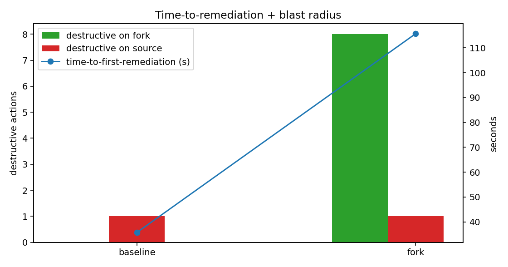
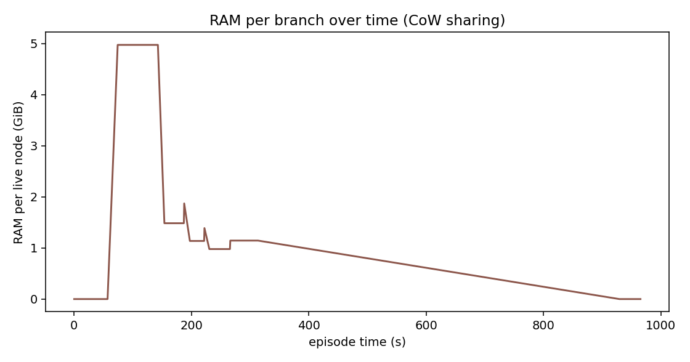

<!--
STATUS: SKELETON . Structure + numbers + plots are
real; prose stubs marked [DRAFT] are for the author's voice.

DISTRIBUTION CHECKLIST (do before publishing, not after):
- [ ] HN title candidates (pick one, keep the others for reposts):
      1. "I gave a frontier model a K8s cluster and a fork button"
      2. "Show HN: k7d - warm-fork a live Kubernetes cluster, let an
         agent debug incidents in parallel universes"
      3. "SRE with a time machine: agent-driven incident response on
         forkable microVM clusters"
- [ ] Cilium/Tetragon community contact (via the Cisco/Isovalent
      relationship): share the Tetragon fork-and-diff scoring section
      before the HN post; ask for a #tetragon Slack thread or a
      community-call slot.
- [ ] MCP install one-liner tested on a clean KVM box (fresh Ubuntu
      24.04 + /dev/kvm): `make k7d-mcp-deps && python3
      examples/k7d-mcp/scenario_incident.py --policy scripted --smoke`
      must pass before the repro block below is published.
- [ ] Video uploaded (docs/assets/k7d-mcp-demo.mp4 or hosted link) and
      README gif swapped.
-->

# I gave a frontier model a cluster and a fork button

[DRAFT - one-paragraph hook. A live 3-node Ubuntu Kubernetes cluster
(Cilium + Tetragon) has an incident. The agent's tools are not
kubectl-on-prod: it gets `fork_batch`, `branch_exec`,
`tetragon_diff`, `protect`, `prune` - a time machine. It forks the
whole cluster, tries destructive fixes in parallel universes, scores
each universe by diffing Tetragon event streams against the source,
and only replays the winning command on production.]

## The setup

[DRAFT - 2 short paragraphs:]

- k7d: purpose-built KVM microVM daemon; a cluster is a tree node;
  warm fork = CoW memory + reflink disks. The MCP server
  (`examples/k7d-mcp/server.py`, stdio, ~120 lines) wraps seven tree
  verbs and nothing else - k7d itself grows no TCP, no auth, no HTTP.
- The agent: OpenAI Codex CLI (Apache-2.0) as the loop, pointed at
  OpenRouter (`moonshotai/kimi-k3`) and at our MCP server. No agent
  framework, no custom loop - a 100-line launcher
  (`examples/k7d-mcp/agent_codex.py`) translates the harness MCP
  config and runs `codex exec`.

The incident catalog is deliberately not told to the agent. The
flagship run is `relay`: a miner Deployment (`node-agent`) whose
host reseed is a dormant systemd path unit a pre-fork inspect
battery cannot name.

## What actually happens (the video)

[VIDEO EMBED - docs/assets/k7d-mcp-demo.mp4]

[DRAFT - narrate the beats: incident fires → agent inspects the
source read-only → wave 1 forks 3 hypothesis clusters (delete /
scale-to-0 / host hunt; RAM gauge climbs) → those shallow fixes
respawn → the agent forks AGAIN from a wave-1 child (depth 2,
peak **21 of 24** live VMs, budget-pressure banner) → winning
theory is a CEL `ValidatingAdmissionPolicy` denying recreation of
`node-agent` → that defense replays on `root` → final Tetragon
diff clean, victim Deployment Ready.]

## The five plots

Rendered by `examples/k7d-mcp/plots.py` from the harness JSONL (every
MCP tool call logs one line: ts, tool, args, latency, usage, budget).
The fork arm below is the **real Codex + kimi-k3 run** from the
video (`docs/assets/k7d-mcp-demo.jsonl`, `relay` incident - miner
Deployment + host path-unit reseed); the baseline arm is the
scripted no-fork run on the same node.

### 1. Tree utilization vs budget


[DRAFT - the "at the limit" story: live VMs and RAM vs `TreeBudget`,
fork waves visible as steps, prune/evict as drops.]

### 2. Fork latency


[DRAFT - honest numbers: two `fork_batch` n=3 waves - **4.4 s** from
the prepared root (live VMs 3→12), **7.8 s** from the wave-1 child
(live VMs 12→21). This is the MCP/gym path (adopted Ubuntu guests,
memory dump-and-load), not the sub-second RuntimeClass path from
blog #6. Name the gap and the 26a-inc2 reason; the sub-250 ms
product path is a different code path with its own enforced budgets.]

### 3. Hypotheses tested vs wall-clock


[DRAFT - the core claim: tree search beats serial trial-and-error.
The real agent run (Codex + kimi-k3, `relay` incident):
**54 tool calls, 972 s** - 2 `fork_batch` n=3 (root, then a
wave-1 child), 47 `branch_exec`, 4 `tetragon_diff`. Depth 2,
peak 21 live VMs. Wave-1 shallow deletes respawned; the wave-2
admission-policy fix replayed on `root`. Scripted baseline
(no forks): every destructive attempt lands directly on production.]

### 4. Remediation blast radius



[DRAFT - destructive actions on forks vs on the live source. Agent
run: competing deletes / scale-to-0 on wave-1 forks (miner
respawned); admission-policy + delete replayed on `root` only after
the soak. Baseline: every attempt is production.]

### 5. RAM per branch



[DRAFT - CoW is what makes the tree affordable. Peak **21 of 24**
budget VMs / ~19 GiB live RAM on the flagship run; budget enforced
by the daemon, not the agent.]

## Reproduce it

Any KVM box (the numbers above: bare-metal AMD Ryzen 5 3600, 64 GiB,
NVMe, Ubuntu 24.04 guests). k7d listens on a Unix socket only.

```bash
# deps for the MCP server + plots (Ubuntu 24.04 is PEP 668 - venv)
make k7d-mcp-deps

# CI arm - everything but the model, both comparison arms, JSONL out
python3 examples/k7d-mcp/scenario_incident.py --policy scripted --both-arms

# frontier arm - Codex CLI (Apache-2.0) + OpenRouter + our MCP server
#   agent shim: examples/k7d-mcp/agent_codex.py (installed as `agent`)
export OPENROUTER_API_KEY=...   # or a 0600 key file, see agent_codex.py
export OPENROUTER_MODEL=moonshotai/kimi-k3
python3 examples/k7d-mcp/scenario_incident.py --policy cursor-agent \
    --incident relay --view http://127.0.0.1:7474

# plots
python3 examples/k7d-mcp/plots.py --dir examples/k7d-mcp/logs --out /tmp/plots
```

MCP config for any other MCP client (Cursor CLI, Claude Code):

```json
{
  "mcpServers": {
    "k7d": {
      "command": "/var/lib/k7d/mcp-venv/bin/python",
      "args": ["examples/k7d-mcp/server.py"],
      "env": {
        "K7D_SOCKET": "/run/k7d/k7d.sock",
        "K7D_TREE_ID": "REPLACE_WITH_TREE_ID",
        "K7D_MCP_LOG": "examples/k7d-mcp/logs/agent.jsonl",
        "K7D_MCP_ARM": "fork",
        "K7D_SOURCE_NODE": "root",
        "K7D_CERTS_DIR": "/tmp/k7-gym-ubuntu-REPLACE_WITH_TREE_ID"
      }
    }
  }
}
```

## Honest limitations

- **Fork cost on this path is seconds, not milliseconds.** The gym
  path adopts running Ubuntu guests (full memory dump-and-load);
  `fork_batch` n=2 measured 2.1-3.9 s. The sub-250 ms warm-fork
  numbers from blog #6 are the RuntimeClass product path with
  prepared base snapshots - different path, different constraints.
- **Single host.** One KVM node, one k7d, no scheduler; the fork
  tree lives and dies on one box.
- **Tetragon scoring is a diff, not a judge.** `tetragon_diff`
  counts branch-only vs source-only events; a quiet incident that
  emits nothing Tetragon watches would score clean.
- **The agent can still hurt production** if it chooses to run a
  destructive command on `root` without proving it on a fork first - 
  the contract is prompt-enforced, budget is daemon-enforced.

## What's next

[DRAFT - one paragraph: k7t record-and-fork , GRPO
training loop on the same gym .]
