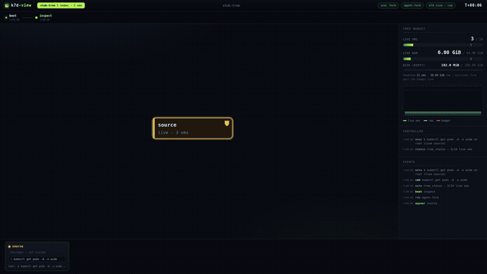
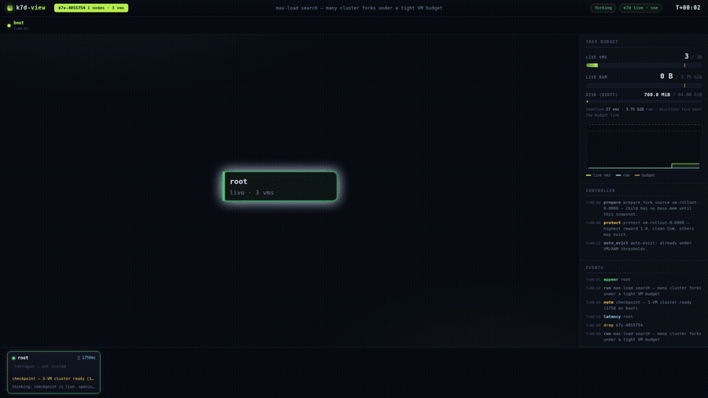

# Someone planted a miner. The SRE has a time machine.

Plain words first, because the rest of this page leans on them: k7d
clones a *running* 3-node Kubernetes cluster - VMs, control plane,
in-flight connections - in about a second per fork, and the copies
share memory until they diverge. This demo hands that clone button
to a frontier model as its main superpower and drops it into an
incident. The agent tries fixes on disposable copies of production,
watches them fail, and only touches the real cluster once a fix has
survived on a copy.

Now the incident.

The attacker hid a CPU miner in a Deployment named `node-agent` - it
looks like a cluster helper, and it burns a core hashing `/dev/zero`
as `/tmp/nodecheck`. The real app, `k7-victim`, is fine. What the
SRE cannot see yet: a host-side respawner that puts the miner back
whenever anyone deletes it.

The defender is Kimi K3 with a fork button. Production is the orange
**source**. It does not get the first knife.

[Watch the run](../assets/k7d-mcp-demo.mp4) ·
[Watch the tree itself](../assets/k7d-tree-view.mp4) (k7view dashboard, 8×) ·
[Pretty page](agent.html) ·
[JSONL](../assets/k7d-mcp-demo.jsonl)

The tree-view video is a second take of the same incident, watched
from the k7view dashboard instead of the transcript: production is
the orange shielded node, forks appear in waves with their fork
latency on the edge, the budget gauge climbs to 21 of 24 live VMs,
losers gray out when pruned, and the winner gets its own shield
before the fix is replayed on production. That take: 50 tool calls,
690 s, three fork waves (4.2 s n=3, 3.4 s n=2, 2.6 s n=1), all
forked from the source
([JSONL](../assets/k7d-tree-view.jsonl)). The narrated run below is
the first take, which also forked *from a fork* (depth 2).

## Three guesses, all wrong

It clones the live cluster three ways (`fork_batch` n=3) and assigns
a theory to each copy:

| Copy | Hypothesis | What happened |
|---|---|---|
| `0000` | Just delete `node-agent` | Gone for thirty seconds. Then it is back. Victim still 2/2. |
| `0001` | Scale it to zero | Same story. Something outside Kubernetes re-applies the spec. |
| `0002` | Watch and wait | Confirms the miner is not a flake. It just sits there burning CPU. |

So a cleanup that “works” is not a fix. The first universe taught
that. The next search starts from `0000` - the copy that already
knows delete is a lie - not from production.

## One copy gets wrecked on purpose

Wave 2, three more copies, 21 of 24 VMs live:

- **`0003`** turns on API audit and restarts k3s so it can catch
  *who* recreates the miner. It finds `system:node:…` doing a
  client-side apply. The miner still comes back in ~19 s. This
  universe now has a restarted control plane and a custom audit
  policy. **Irreparable, and that is fine** - it is a fork. Nobody
  rolls it back. It was a lab.
- **`0004`** tries “stop the guest agent, then delete.” The command
  times out. Another burned copy.
- **`0005`** deletes the miner *and* hangs a
  `ValidatingAdmissionPolicy` on the name `node-agent`. Recreate
  attempts come back `denied`. The victim stays Ready. A long soak:
  still gone.

No `rollback`. The broken labs stay broken. The point of the tree is
that you can afford that.

## The win

Only then does it touch production. Same two moves that held on
`0005`: delete the miner, install the lock. Soak. Try to see it
respawn. It does not.

`k7-victim` is 2/2. Tetragon of the source is clean. The attacker
can still twitch on the host - the API will not take the body.

That is the whole trick. First guesses die on copies. One copy is
sacrificed to learn the respawner’s handwriting. The keeper is a
door that stays shut. Production only sees the door.

  

## The tree can go deeper than one level

The agent takes above happened to win at depth 1 or 2. The tree
itself forks from any live node: below is the deterministic
multi-wave scenario (`examples/k7view/run_scenario.py --profile max
--no-vm-tree`) on busybox 3-VM clusters — wave 0 forks 8 from root,
wave 1 forks from the wave-0 winner, wave 2 from the wave-1 winner:
root → child → grandchild → great-grandchild, with losers parked
along the way. Real parent edges from the daemon; the UI does not
invent topology. [mp4](../assets/k7d-tree-depth3.mp4)

  

## A harder incident, and an honest measurement of what the fork button buys

The miner above comes back once, from one host respawner. Real
cryptojacking is layered and self-healing. In the XMRig campaign that
Innora traced on bare-metal (the same cloud these nodes run on), the
persistence was a [three-layer architecture](https://innora.ai/blog/cloud-cryptojacking-xmrig-hetzner-rescue-mode-analysis)
— the miner, a restore script, and a crontab entry — and *"removing
only the binary or killing the process ... will result in automatic
reinstallation within 30 minutes."* Kinsing does the same with a cron
job that [re-downloads every minute](https://www.trendmicro.com/en/research/20/k/analysis-of-kinsing-malwares-use-of-rootkit.html)
plus a systemd service and an LD_PRELOAD rootkit. And Huntress
documented an incident where [an AI agent was doing the cleanup](https://www.huntress.com/blog/codex-part-two)
and a persistence path it *"had never checked"* quietly re-established
control while it worked.

So we built that incident (`dormant` in the demo catalog): the miner,
a **hidden** reseeder that only reveals itself after you delete the
miner and wait, and a **hidden** guard behind that which reinstalls
the reseeder if you remove it — three layers, each invisible until the
one above it is destroyed, and each reacting on a delay so you cannot
confirm a fix without a real soak. A visible-but-inert cron entry sits
in plain sight as a red herring, exactly like the obvious artifact the
Huntress agent cleaned while missing the real one.

Then we ran the **same frontier model twice** on it — once with the
fork button, once with it taken away (it may only act on production) —
and measured where the destructive work landed:

| | Fork button | No fork button |
|---|---|---|
| Fixed it? | yes (victim 2/2, all 3 layers gone) | yes (victim 2/2, all 3 layers gone) |
| Wall-clock | 1292 s | 1133 s |
| State-changing commands **on production** | **1** | **7** |
| State-changing commands on throwaway copies | 7 | 0 |
| Rollback available if a step went wrong | yes | no |

The honest headline is the part people do not expect: for a model this
capable, the fork button did **not** make it faster — the no-fork run
was actually a bit quicker. Both agents mapped the same three-layer
chain and removed it. What changed is **where the trial-and-error
happened**. The fork agent stopped systemd units, deleted the
deployment, and removed files on disposable copies — seven
state-changing commands, none of them on the live cluster — soaked
each candidate past the delayed reseed to be sure it held, and only
then replayed the one validated fix on production (a single mutating
command). The no-fork agent had no choice: all seven of those same
destructive, exploratory steps ran on the real cluster, with `rollback`
unavailable if any had been wrong.

That is the case for the fork button, stated without exaggeration: on
an easy incident a good agent is fine either way, and on this one the
outcomes matched. The fork button is insurance you buy for the run
where a discovery step *is* wrong — where "stop this unit" on
production takes down something you needed. Here it moved six of seven
destructive operations off production and kept a rollback in hand, for
about 14% more wall-clock.

[Watch the fork run](../assets/k7d-dormant-fork.mp4) (k7view, 6×) ·
[fork JSONL](../assets/k7d-dormant-fork.jsonl) ·
[no-fork JSONL](../assets/k7d-dormant-baseline.jsonl)

One thing we did **not** get, and will not claim: on this incident the
model did not fork a copy *of a copy* on its own. Once it can read the
chain, the fix is deterministic, so it peeled all three layers with
careful serial investigation on a single disposable copy (fork depth
1) rather than branching deep. Agent-chosen depth shows up when the
model is genuinely uncertain and wants to try competing theories in
parallel; the deterministic multi-wave clip above is where you can see
the tree itself go three levels deep on demand.
